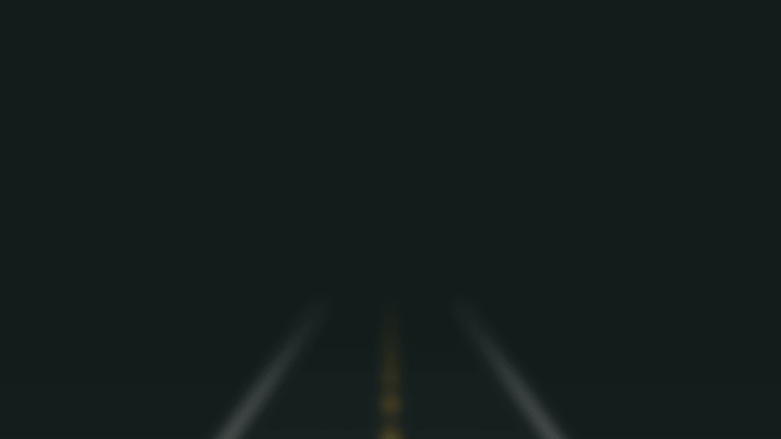
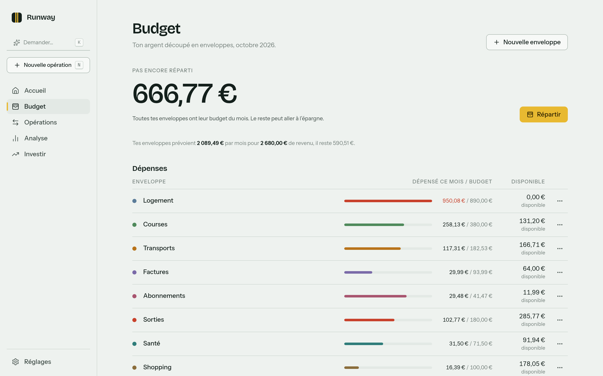
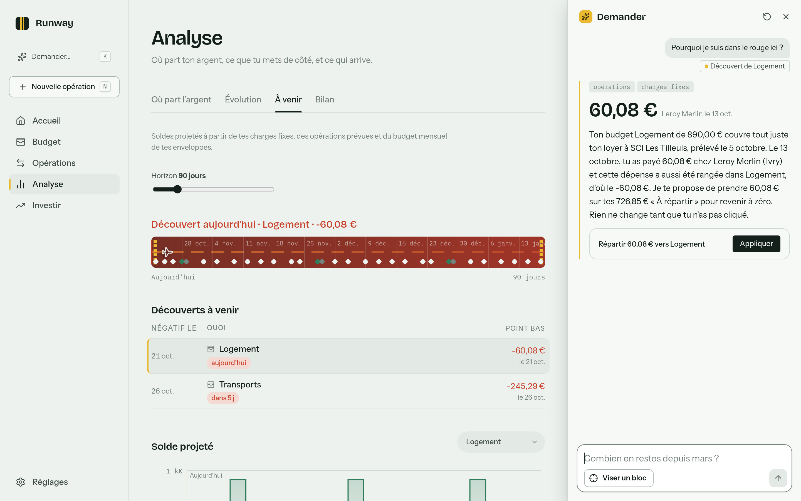
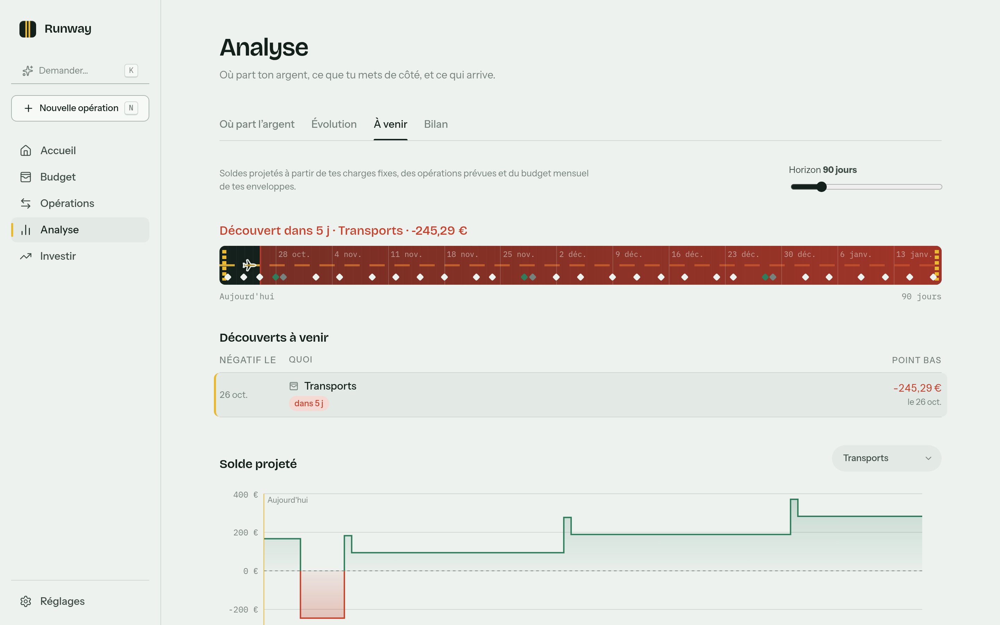
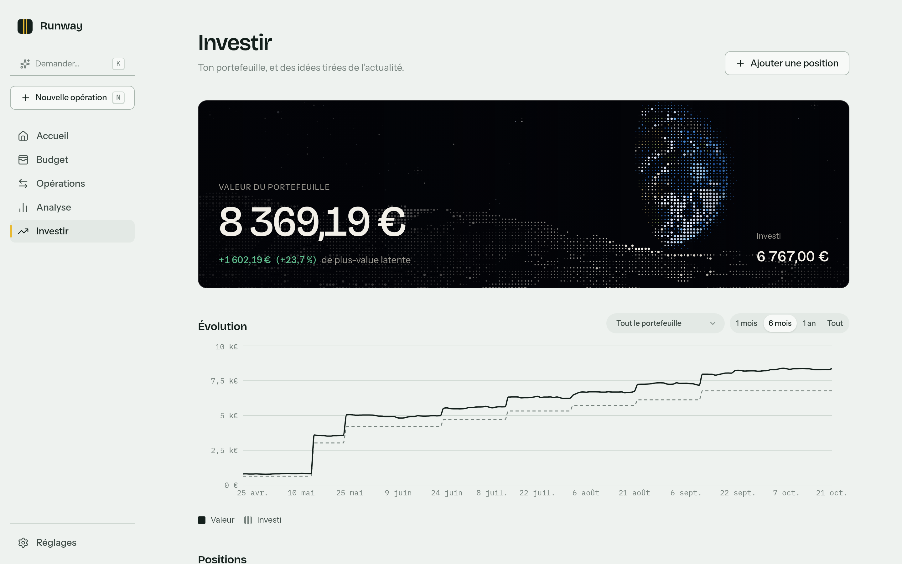
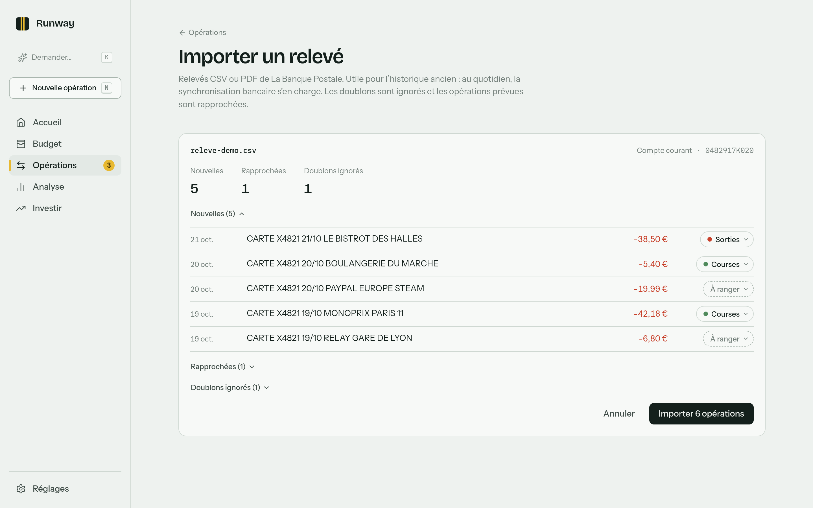
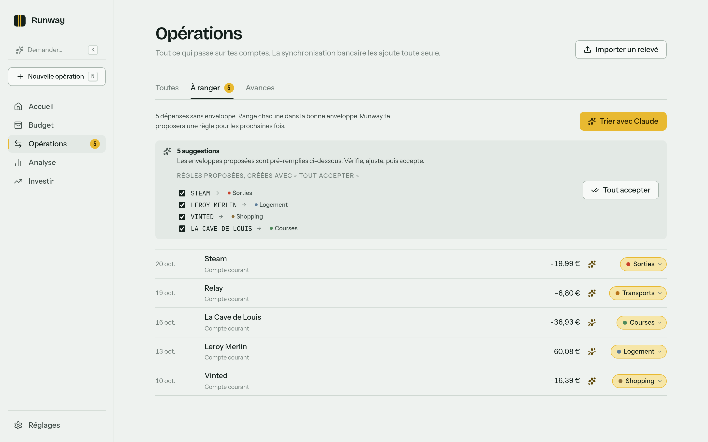

<p align="center">
  <a href="docs/media/runway-presentation.mp4">
    
  </a>
</p>

<h1 align="center">Runway</h1>

<p align="center">
  <b>Ton argent, jusqu'à la prochaine paie.</b><br>
  Budget par enveloppes, prévision de découvert et tri des opérations par Claude, sur ta machine.
</p>

<p align="center">
  
  
  
  
</p>

<p align="center">
  <a href="docs/media/runway-presentation.mp4"><b>▶ Regarder la présentation (30 s)</b></a>
</p>

Runway tourne sur ta machine : un serveur Node sert l'interface et l'API, et toutes les données vivent dans un fichier SQLite.
Pas de compte, pas de cloud, pas d'abonnement.
Les relevés La Banque Postale s'importent tels quels, les charges fixes deviennent des règles récurrentes, et Claude range ce qui reste.

## Ce que fait Runway

<table>
  <tr>
    <td width="50%" valign="top">
      
      <h3>Chaque euro a sa place</h3>
      Ton argent est découpé en enveloppes.
      Les charges fixes donnent leur budget (le loyer fait celui de Logement), et le reste se répartit d'un geste.
    </td>
    <td width="50%" valign="top">
      
      <h3>Demande à Claude</h3>
      Vise un bloc de l'écran et pose ta question.
      Claude lit tes données sans rien modifier, et propose des actions que tu appliques d'un clic.
    </td>
  </tr>
  <tr>
    <td width="50%" valign="top">
      
      <h3>Vois venir le découvert</h3>
      Charges fixes, budget et opérations prévues projettent les soldes de chaque compte et de chaque enveloppe.
      La piste rougit bien avant le problème.
    </td>
    <td width="50%" valign="top">
      
      <h3>Investir, en clair</h3>
      Trade Republic et Binance au même endroit, avec les cours de Yahoo Finance.
      Chaque semaine, Claude tire des idées de l'actualité et les juge face au S&amp;P 500.
    </td>
  </tr>
  <tr>
    <td width="50%" valign="top">
      
      <h3>Un relevé, tout rangé</h3>
      Les doublons sont ignorés et les prélèvements prévus rapprochés.
      Les opérations reconnues par une règle de tri arrivent déjà dans leur enveloppe.
    </td>
    <td width="50%" valign="top">
      
      <h3>Claude trie le reste</h3>
      Une enveloppe proposée et expliquée pour chaque opération à ranger, et des règles pour les prochaines fois.
      Le tout passe par ton abonnement Claude, sans clé API.
    </td>
  </tr>
</table>

<sub>Captures et vidéo faites sur une base de démonstration aux données inventées.</sub>

## Prérequis

- Node 24 ou plus récent.
- Pour le tri, Demander et les idées d'Investir : [Claude Code](https://docs.anthropic.com/claude-code) installé et connecté (`claude`, puis `/login`).
  Runway utilise `claude -p` sur ton abonnement, aucune clé API n'est nécessaire.

## Démarrer en développement

```sh
npm install
npm run dev
```

L'API écoute sur http://localhost:3000 et l'interface sur http://localhost:5173 (rechargement à chaud).
L'interface est aussi accessible depuis un téléphone sur le même réseau, à l'adresse affichée par Vite.

## Lancer en production locale

```sh
npm run build
npm start
```

Tout est servi sur http://localhost:3000.
La variable `PORT` change le port, et `RUNWAY_DB` le chemin de la base.

## Où sont les données

Dans `data/runway.db` (gitignoré).
Les Réglages proposent aussi un export JSON complet et un export CSV des opérations.

## Sauvegardes et restauration

Le serveur se sauvegarde lui-même, sans réglage : au démarrage (avant une éventuelle migration), une fois par jour tant qu'il tourne, et juste avant chaque restauration.
Les sauvegardes vivent dans `data/backups/`, au format `runway-<date>T<heure>-<raison>.db`, et sont conservées 30 jours puis une par mois calendaire (les sauvegardes manuelles et celles d'avant restauration ne sont jamais supprimées automatiquement).

Réglages > Général, section Données :

- l'état de la dernière sauvegarde, et d'un second dossier facultatif (clé USB, NAS, dossier synchronisé) pour survivre à une panne de la machine ;
- le bouton "Sauvegarder maintenant" ;
- la liste des sauvegardes, avec la restauration dans le menu de chaque ligne (confirmée, et toujours précédée d'une sauvegarde de l'état actuel pour pouvoir se raviser).

En ligne de commande, serveur allumé ou non :

```sh
npm run db:backup                      # raison "manuelle"
npm run db:backup -- "avant purge"     # raison personnalisée
```

Lit `RUNWAY_DB` comme le serveur.

## Importer un relevé La Banque Postale

1. Dans l'espace client, télécharge l'export CSV du compte (menu "Télécharger les opérations"), ou le relevé mensuel PDF.
2. Dans Runway, Opérations puis "Importer un relevé", dépose le fichier.
3. L'aperçu classe les lignes en nouvelles, rapprochées (une opération prévue par une règle récurrente qui correspond) et doublons (déjà importées).
4. Confirme : les dépenses sans règle de tri arrivent dans "À ranger".

Au premier import, le numéro de compte lu dans le fichier est mémorisé sur le compte Runway, et les imports suivants le retrouvent seuls.

## Investir

L'écran Investir suit ton portefeuille et propose des idées d'investissement tirées de l'actualité.

- Trade Republic n'a pas d'API : ajoute ta position (recherche par nom, ticker ou ISIN) puis chaque achat ou vente.
  Les cours viennent de Yahoo Finance, sans clé, et sont mis en cache dans la base.
- Binance se synchronise à l'ouverture de l'écran avec une clé API en lecture seule (Profil, Gestion des API, ne cocher que « Activer la lecture »).
  Runway refuse une clé qui peut trader ou retirer, et ne renvoie jamais la clé au navigateur.
- Les idées sont cherchées par Claude sur le web (`claude -p` avec la recherche web), une fois par semaine à l'ouverture de l'écran ou à la demande.
  Chaque idée garde son cours de départ et se clôt à son horizon : le bilan dit si elles battent le S&P 500.

## Commandes

| Commande | Rôle |
|---|---|
| `npm run dev` | serveur + client en mode développement |
| `npm run build` | construit le client dans `client/dist` |
| `npm start` | serveur de production |
| `npm test` | tous les tests (vitest) |
| `npm run typecheck` | vérification TypeScript |
| `npm run lint` | eslint |
| `npm run db:generate` | génère une migration après modification de `server/src/db/schema.ts` |
| `npm run db:backup` | sauvegarde manuelle immédiate, serveur allumé ou non |

## Refaire la vidéo et les captures

La vidéo est un projet [Remotion](https://www.remotion.dev) dans `video/`, avec ses propres dépendances.
Les écrans y sont redessinés et animés ; seules les captures de `docs/media/screens/`, partagées avec ce README, défilent à la fin.

```sh
cd video
npm install
npm run render     # vidéo, affiche et GIF dans docs/media/
npm run studio     # aperçu image par image dans le navigateur
```

Pour refaire les captures, `npm run recette` (dans `video/`) monte une base de démonstration neuve dans `tmp/video/`, remplie de données inventées, et sert l'app sur http://localhost:5180.
La vraie base de `data/` n'est jamais touchée.
Les étapes à jouer dans l'app avant chaque capture sont décrites en tête de `video/scripts/recette.sh`.

## Structure

```
shared/   schémas zod, types et utilitaires partagés (montants, dates)
core/     moteur pur : soldes, récurrence, prévision, rapprochement, tri
server/   Hono + Drizzle + SQLite, parsers CSV, service Claude
client/   React + Vite
video/    vidéo de présentation (Remotion) et données de démonstration
docs/     spec de design, plan d'implémentation, vidéo et captures du README
```

Le spec complet est dans `docs/superpowers/specs/2026-10-02-runway-design.md`.
